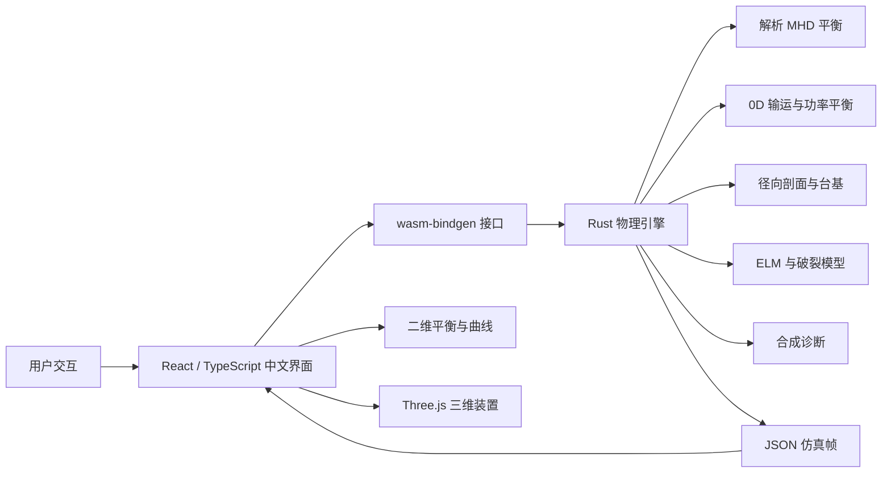

> [!IMPORTANT]
> **原始项目：** [d-burg/fusion-sim](https://github.com/d-burg/fusion-sim)
>
> 本仓库是由 [Duery](https://github.com/Duery) 基于原始项目开发和维护的 **HL-3 中文增强版本**。
> 联系邮箱：[ouyanghongjia@swip.ac.cn](mailto:ouyanghongjia@swip.ac.cn)

<div align="center">

# fusion-sim-hl3

**在浏览器中实时运行的 HL-3 托卡马克等离子体交互仿真平台**

Rust / WebAssembly 物理引擎 · React 中文控制台 · 多装置交互仿真

[](https://132.232.252.53/)
[](https://www.rust-lang.org/)
[](https://react.dev/)
[](https://www.typescriptlang.org/)
[](LICENSE)

[在线体验](https://132.232.252.53/) · [快速开始](#快速开始) · [HL-3 增强内容](#hl-3-增强内容) · [项目架构](#项目架构) · [参与贡献](#参与贡献)

</div>


## 项目简介

`fusion-sim-hl3` 是一个完全运行在浏览器中的托卡马克等离子体交互仿真平台。项目使用 Rust 编写物理引擎并编译为 WebAssembly，通过 React、TypeScript 和 Three.js 构建可交互的中文控制台，可用于观察放电演化、调整运行参数并理解托卡马克基础物理过程。

本分支在原始项目基础上重点补充了 HL-3 装置：重新构建第一壁几何并更新工程参数。当前平台面向教学、展示与概念验证，不是工程设计工具，也不是可替代实验分析和高保真输运程序的预测代码。

## 主要特性

- **六套装置模型：** DIII-D、HL-3、EAST、JET、ITER，以及概念型负三角形变装置 CENTAUR。
- **全中文界面：** 设备选择、控制室、放电规划、诊断曲线、参数说明与参考资料均已汉化。
- **HL-3 专项增强：** 基于项目资料重建 2 m 尺度第一壁外形，并更新装置运行参数。
- **浏览器实时仿真：** Rust 物理内核通过 WebAssembly 在本地运行，无需后端计算服务。
- **交互式控制室：** 二维平衡位形、时间序列、等离子体状态、三维装置视图和放电规划器协同展示。
- **多种放电场景：** 支持 H 模、L 模与密度极限等预设，也可修改等离子体电流、加热功率、密度和形状参数。
- **合成诊断与后处理：** 展示聚变功率、增益因子、快中子率、偏滤器热负荷、径向剖面等派生量。
- **响应式开源字体：** 中文界面使用 Noto Sans SC，数值与等宽内容使用 IBM Plex Mono，字体文件随项目自托管。

## HL-3 增强内容

### 装置参数

| 参数 | 当前模型值 | 说明 |
| --- | ---: | --- |
| 大半径 $R_0$ | 1.78 m | HL-3 主半径 |
| 小半径 $a$ | 0.65 m | 等离子体特征小半径 |
| 最高环向磁场 $B_T$ | 2.3 T | 当前版本运行上限 |
| 最高等离子体电流 $I_p$ | 3.0 MA | 当前版本运行上限 |
| 偏滤器构型 | 下单零 | Lower Single Null |
| 基线燃料 | D-D | 用于当前仿真场景 |

HL-3 第一壁不是简单的椭圆或圆环外壳。当前版本依据项目资料中的 `addFirstWall_2m.m` 几何信息重新生成边界，使二维截面与三维外壳更接近 2 m 装置的实际轮廓。

### EAST 公开参数近似模型

EAST 模型采用公开资料给出的约束范围：$R_0=1.85\,\mathrm{m}$、$a=0.45\,\mathrm{m}$、$B_T\le3.5\,\mathrm{T}$、$I_p\le1.0\,\mathrm{MA}$，基线伸长比取 1.8、三角度取 0.5。由于仓库没有 EAST 工程/CAD 第一壁数据，当前外壳仅为带合理间隙的 D 形近似，不能用于判断真实部件位置或靶板几何。参数参考 [中国科学院合肥物质科学研究院 EAST 介绍](https://english.hf.cas.cn/ic/ip/east/) 与 [Scientific Reports 装置参数说明](https://doi.org/10.1038/srep32440)。

## 在线体验

已部署版本：**[https://132.232.252.53/](https://132.232.252.53/)**

浏览器会加载 WebAssembly 物理内核，首次打开可能需要短暂等待。推荐使用最新版 Chrome、Edge 或 Firefox，并启用 WebGL。

## 快速开始

### 环境要求

- [Rust](https://rustup.rs/) 稳定版工具链
- [wasm-pack](https://rustwasm.github.io/wasm-pack/installer/)
- [Node.js](https://nodejs.org/) 18 或更高版本
- npm

安装 `wasm-pack`：

```bash
cargo install wasm-pack
```

### 克隆并启动

```bash
git clone https://github.com/Duery/fuison-sim-hl3.git
cd fuison-sim-hl3

# 编译 Rust 物理引擎为 WebAssembly
wasm-pack build crates/tok-sym-core \
  --target web \
  --out-dir ../../web/src/wasm \
  --features wasm \
  --no-default-features

# 安装前端依赖并启动开发服务器
cd web
npm install
npm run dev
```

开发服务器默认地址为 `http://localhost:5173`。

### 构建生产版本

```bash
cd web
npm run build
```

构建结果位于 `web/dist/`。可使用 Vite 进行本地预览：

```bash
npm run preview -- --host 127.0.0.1
```

### 运行检查

```bash
# Rust 物理引擎测试
cargo test -p tok-sym-core

# TypeScript 类型检查与生产构建
cd web
npx tsc -b
npm run build

# 前端代码检查
npm run lint
```

生成 Rust API 文档：

```bash
cargo doc -p tok-sym-core --no-deps --open
```

## 项目架构



```text
fusion-sim-hl3/
├── crates/tok-sym-core/       Rust / WebAssembly 物理引擎
│   └── src/
│       ├── equilibrium.rs     解析 Grad–Shafranov 平衡
│       ├── transport.rs       0D 功率平衡与约束标度
│       ├── profiles.rs        Tanh 台基径向剖面
│       ├── devices.rs         六套装置参数与几何定义
│       ├── disruption.rs      破裂风险和动力学
│       ├── diagnostics.rs     合成诊断信号
│       ├── contour.rs         等值线提取
│       ├── simulation.rs      仿真流程编排
│       └── wasm_api.rs        WebAssembly API
├── web/                       React 中文前端
│   ├── public/                图标、字体元数据与静态资源
│   └── src/
│       ├── components/        控制室、二维/三维视图与面板
│       ├── pages/             页面与路由
│       ├── lib/               WASM 初始化、Hooks 与共享逻辑
│       └── wasm/              生成的 WebAssembly 文件
├── ARCHITECTURE.md            详细架构说明
└── LICENSE                    GPL-3.0 许可证
```

更完整的模块说明请参阅 [ARCHITECTURE.md](ARCHITECTURE.md)。

## 物理模型

| 模型 | 实现或参考方向 |
| --- | --- |
| MHD 平衡 | Cerfon–Freidberg 解析 Grad–Shafranov 解 |
| 能量约束 | IPB98(y,2) 标度 |
| L–H 转换 | Martin 功率阈值标度 |
| Beta 极限 | Troyon 归一化 Beta 极限 |
| 密度极限 | Greenwald 密度极限 |
| 聚变反应率 | Bosch–Hale 参数化 |
| 偏滤器热流 | Eich SOL 宽度标度 |
| 径向剖面 | OMFIT 风格 Tanh 台基参数化 |

应用内“参考文献”页面提供了更完整的公式和文献说明。

## 技术栈

- **物理引擎：** Rust、wasm-bindgen、WebAssembly
- **前端：** React 19、TypeScript 5.9、Vite 7.3
- **样式：** Tailwind CSS 4.2
- **三维渲染：** Three.js 与自定义 GLSL 着色器
- **二维渲染：** HTML Canvas API
- **字体：** Noto Sans SC、IBM Plex Mono（SIL Open Font License 1.1）

## 模型边界

> [!CAUTION]
> 本项目采用 0D 输运标度、解析平衡和简化事件模型，输出主要用于教学演示、交互探索和概念验证。它不能替代实验数据处理、输运求解、MHD 稳定性分析、安全联锁或工程设计软件，也不应直接用于装置运行决策。

## 后续方向

- [ ] 增加更多装置的公开几何与运行场景
- [ ] 增加中英文界面切换与更多装置资料

## 参与贡献

欢迎提交 Issue 和 Pull Request。为便于审查，请在贡献时：

1. 清楚说明问题、使用场景和预期结果。
2. 涉及物理模型时提供公式、参数来源或公开文献。
3. 涉及装置参数或几何时，请明确数据来源、坐标系和近似范围。
4. 提交前运行 Rust 测试和前端构建检查。
5. 不要提交实验敏感数据、密钥、服务器凭据或未经授权的资料。

## 致谢

- 感谢 [d-burg/fusion-sim](https://github.com/d-burg/fusion-sim) 原始项目提供物理仿真与交互界面的基础实现。
- 感谢 Rust、WebAssembly、React、Three.js 及相关开源社区。
- HL-3 第一壁增强依据项目随附几何资料整理；原始资料及其中数据的权利归各自权利人所有。

## 维护者

- **开发与维护：** [Duery](https://github.com/Duery)
- **邮箱：** [ouyanghongjia@swip.ac.cn](mailto:ouyanghongjia@swip.ac.cn)

## 许可证

本仓库以根目录 [LICENSE](LICENSE) 文件为准，采用 **GNU General Public License v3.0（GPL-3.0）** 发布。上游项目、第三方依赖、字体和资料仍分别遵循其原有许可证及版权声明。

如果这个项目对你有帮助，欢迎点亮 ⭐，也欢迎通过 Issue 分享建议与使用反馈。
